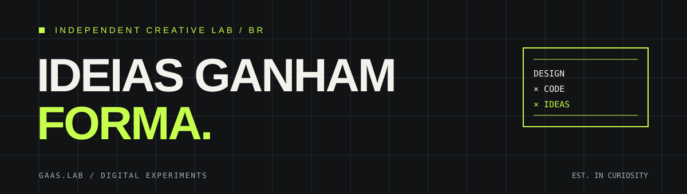

<div align="center">

# gaas.lab

### IDEIAS GANHAM FORMA.

**DESIGN × CODE × IDEAS**

Laboratório independente de design, tecnologia e experimentação digital.



[O Ponto](#-o-ponto) · [Funcionalidades](#-o-que-você-encontra) · [Começar](#-começar) · [Privacidade](PRIVACIDADE.md) · [Termos](TERMOS_DE_USO.md)

</div>

---

## // O ponto.

O **ponto.** é uma aplicação web para registrar a jornada de trabalho, acompanhar o saldo de horas e estimar o horário de saída. Reúne calendário, dashboard, histórico, relatórios e exportação de dados.

Foi criado para deixar os registros do expediente e o saldo de horas fáceis de consultar, em uma interface que funciona no computador e no celular.

> Um jeito mais claro de acompanhar o tempo de trabalho, do primeiro registro à hora de sair.

### O que você encontra

- Batidas de entrada, saída para almoço, retorno e fim do expediente.
- Previsão de saída com opção de considerar o saldo acumulado.
- Calendário mensal, semanal e diário, com feriados nacionais.
- Dashboard mensal com gráfico diário e indicadores de saldo.
- Relatório pronto para impressão ou salvamento em PDF.
- Importação de registros em `.xlsx`, `.xls` ou `.csv` e exportação para Excel.
- Aviso do navegador dez minutos antes da previsão de saída, mediante permissão.
- Perfil com foto, tema claro ou escuro e layout adaptável ao celular.
- Sincronização segura dos registros com o Supabase.

## // Como funciona

O tempo trabalhado soma os períodos entre entrada e saída para almoço e entre retorno e saída final. O intervalo não entra no total.

```text
saldo do dia = tempo trabalhado − carga horária global
```

O saldo é fechado quando as quatro batidas estão registradas. Dias incompletos aparecem como em andamento e ficam fora do saldo acumulado. Se o intervalo ainda não foi concluído, a previsão de saída considera uma hora.

A carga horária global começa em **8h48min** e pode ser ajustada pela conta master. Essa conta também pode consultar registros de todos os usuários e apagar os registros de um mês para a conta selecionada. As permissões são aplicadas na interface e no banco de dados.

> A conta master autorizada atualmente é `gaasbrel@gmail.com`. Se o endereço mudar, atualize as verificações em `src/main.jsx` e `supabase/setup.sql`.

## // Tecnologias

| Tecnologia | Papel no projeto |
| --- | --- |
| React 18 + Vite 6 | Interface e desenvolvimento |
| CSS | Temas, layout e responsividade |
| Supabase Auth | Cadastro, login e sessão |
| Supabase Postgres + RLS | Registros, configuração e permissões |
| Supabase Storage | Fotos de perfil |
| SheetJS (`xlsx`) | Importação e exportação de planilhas |
| Lucide React | Ícones |
| BrasilAPI | Consulta de feriados nacionais |
| Vercel | Hospedagem e publicação |

## // Começar

### Pré-requisitos

- Node.js e npm
- Um projeto Supabase configurado

### 1. Instale as dependências

```bash
git clone https://github.com/gaas-lab/ponto..git
cd 'ponto.'
npm install
```

### 2. Configure o Supabase

Copie o arquivo de exemplo e preencha as variáveis:

```bash
cp .env.example .env.local
```

```dotenv
VITE_SUPABASE_URL=https://SEU-PROJETO.supabase.co
VITE_SUPABASE_PUBLISHABLE_KEY=SUA_CHAVE_PUBLICAVEL
```

Também é possível usar `VITE_SUPABASE_ANON_KEY` no lugar da chave publicável. Execute `supabase/setup.sql` no SQL Editor do projeto. No Supabase Auth, habilite e-mail e senha e, se necessário, adicione `http://localhost:5173` às URLs autorizadas.

### 3. Rode localmente

```bash
npm run dev
```

Para conferir o build de produção:

```bash
npm run build
npm run preview
```

### Publicar na Vercel

Importe o repositório, configure `VITE_SUPABASE_URL` e `VITE_SUPABASE_PUBLISHABLE_KEY` e publique. Depois, adicione o domínio publicado às URLs autorizadas no Supabase Auth.

> As variáveis `VITE_*` vão para o bundle do navegador. Use apenas a chave publicável/anon do Supabase; nunca coloque uma `service_role` ou outro segredo nelas.

## // Estrutura

```text
.
├── index.html
├── assets/
│   └── gaas-lab-banner.svg
├── src/
│   ├── main.jsx                 # Aplicação, páginas e cálculos
│   ├── styles.css               # Estilos base e componentes
│   ├── design.css               # Temas e layout responsivo
│   ├── components/
│   │   ├── Account.jsx          # Login, cadastro e perfil
│   │   └── account.css
│   └── lib/
│       ├── supabase.js          # Cliente Supabase
│       └── spreadsheet.js       # Importação e exportação
└── supabase/
    └── setup.sql                # Tabelas, RLS, função master e Storage
```

## // Dados e segurança

- Cada usuário pode consultar e alterar os próprios registros.
- A conta master pode administrar registros de todas as contas.
- As políticas de Row Level Security (RLS) aplicam permissões no Postgres.
- As fotos ficam em bucket privado e são exibidas por URLs assinadas temporárias.
- A autenticação e a sessão são gerenciadas pelo Supabase Auth.

## // Licença e documentos legais

O código deste repositório é distribuído sob a [licença MIT](LICENSE), com direitos autorais de Gabriel Rocha.

Os textos de [Privacidade](PRIVACIDADE.md) e [Termos de Uso](TERMOS_DE_USO.md) são rascunhos para revisão. As pendências técnicas e factuais estão em [Revisão legal](REVISAO_LEGAL.md); confirme essas informações antes de apresentar os textos como vigentes.

## // Roadmap

- [x] Dashboard e gráfico diário de horas
- [x] Carga horária global administrável
- [x] Relatório mensal e exportação para PDF
- [x] Importação e exportação de planilhas
- [x] Histórico completo e calendário mensal, semanal e diário
- [x] Tema claro/escuro e aviso de previsão de saída
- [ ] PWA instalável
- [ ] Jornadas diferentes por usuário
- [ ] Banco de horas com regras de compensação
- [ ] Melhorias adicionais de acessibilidade

## // Créditos

Desenvolvido por **Gabriel Rocha** · [Gaaslab](https://github.com/gaas-lab).

<div align="center">

`DESIGN × CODE × IDEAS`

<sub>Um projeto gaas.lab. Feito de perguntas, protótipos e commits.</sub>

</div>
